# Communication Systems

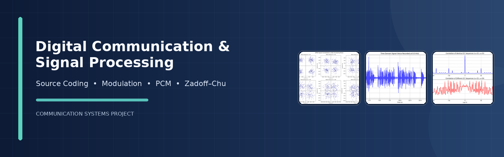

A Python-based communication-systems project covering digital source and channel coding, noisy-channel simulation, digital modulation, speech sampling, quantization, companding, and synchronization-related signal processing.

## Project scope

- **Information source and source coding:** entropy calculation, fixed-length coding, Huffman coding, and random source generation.
- **Channel coding:** implementation and evaluation of the Hamming \((7,4)\) code.
- **Communication channel:** channel effects, additive white Gaussian noise (AWGN), matched filtering, and the end-to-end signal chain.
- **Digital modulation:** 4-FSK, QPSK, and 16-QAM, including BER-versus-noise analysis, constellation diagrams, and eye diagrams.
- **Speech signal processing:** 8 kHz voice sampling, uniform PCM quantization, quantization-noise analysis, and \(\mu\)-law companding.
- **Synchronization and random access:** Zadoff–Chu sequence correlation, MIB-pattern detection, and a simplified RACH preamble procedure.

## Repository structure

```text
Communication-Systems/
├── README.md
├── requirements.txt
├── report/
│   └── Communication_Systems_Project_Report.pdf
├── notebooks/
│   ├── Part2_code.ipynb
│   ├── Part4_code.ipynb
│   └── Part5_code.ipynb
├── audio/
│   ├── my_voice_8k.wav
│   ├── reconstructed_uniform.wav
│   └── reconstructed_companded.wav
└── images/
    ├── banner.png
    └── simulation figures exported from the notebooks
```

## Getting started

Use Python 3 and install the dependencies:

```bash
python -m pip install -r requirements.txt
```

Launch Jupyter from the repository directory:

```bash
jupyter lab
```

Open the notebooks in `notebooks/`. The notebooks contain saved outputs from the submitted work.

### Audio recording note

`Part4_code.ipynb` includes a microphone-recording step using `sounddevice`. Re-running that cell requires microphone access. The submitted 20-second mono WAV recordings are included in `audio/` (8 kHz, 16-bit PCM).

## Simulation gallery

### Digital modulation

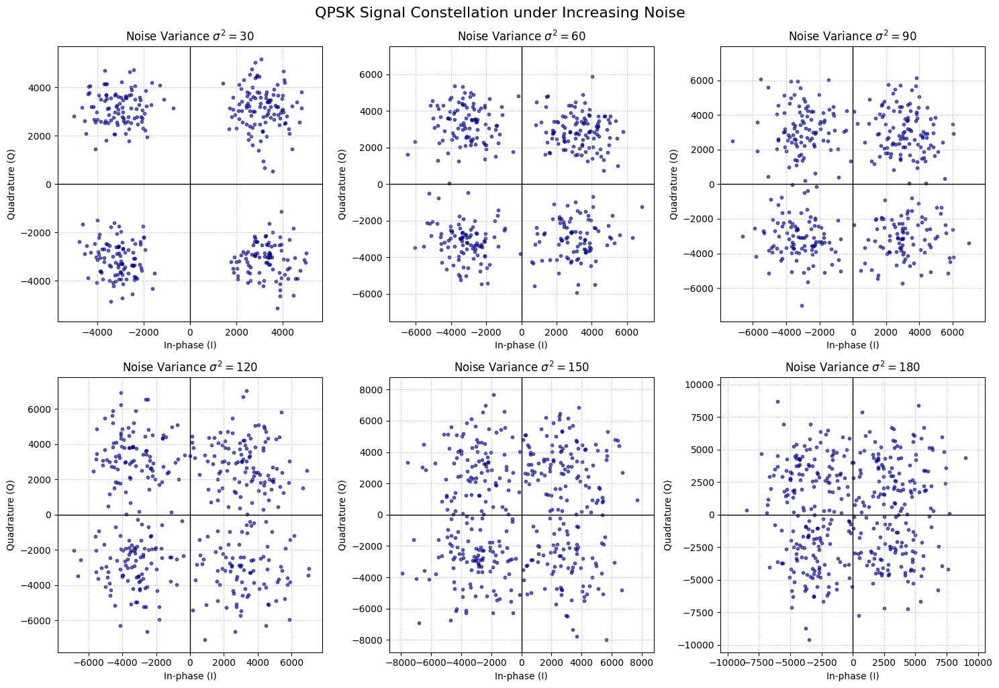

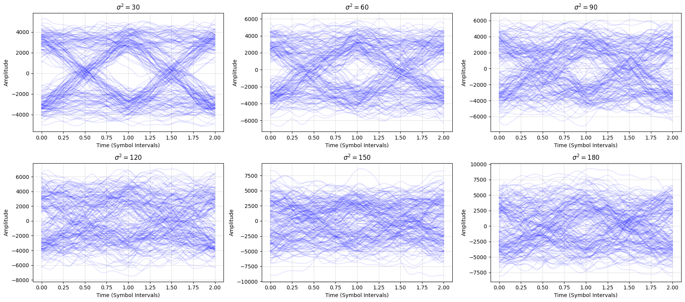

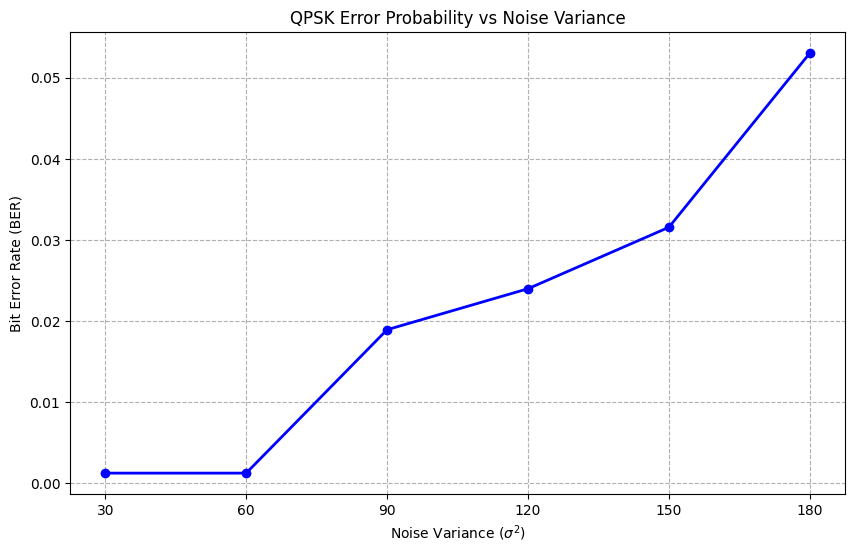

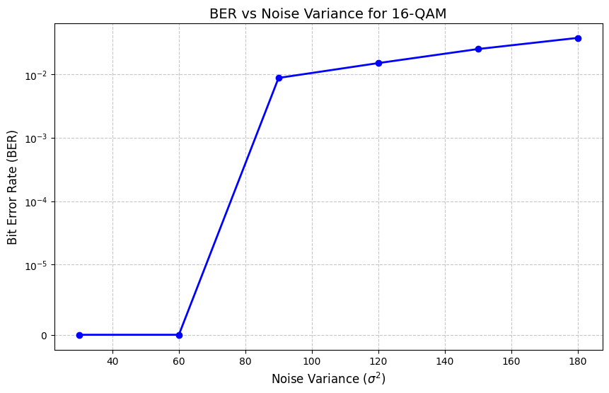

### Speech sampling and quantization

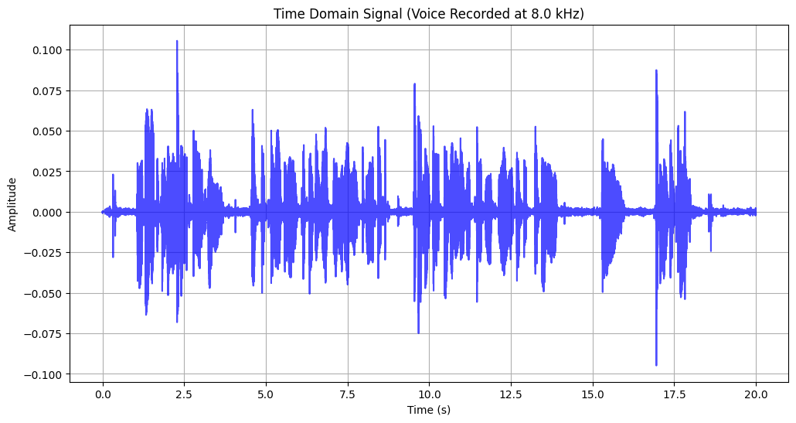

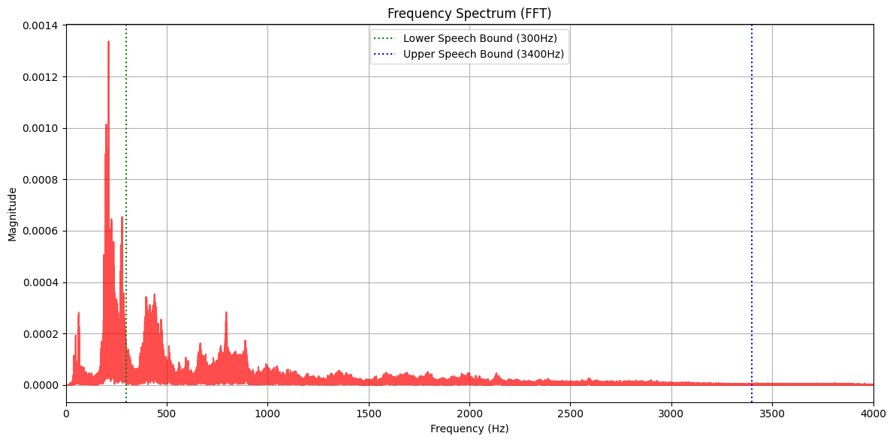

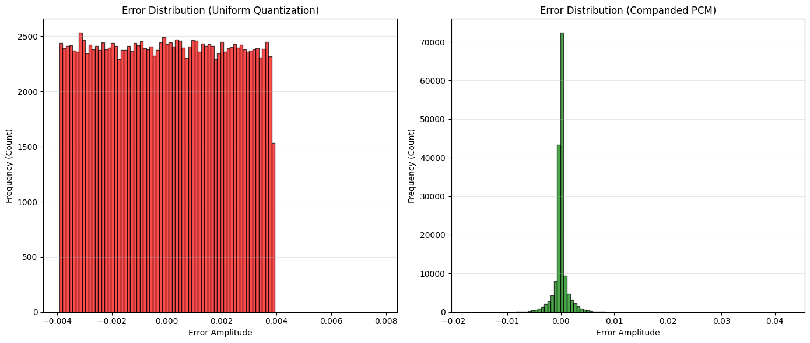

### Synchronization and random access

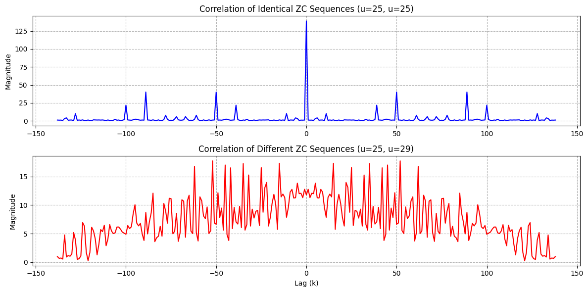

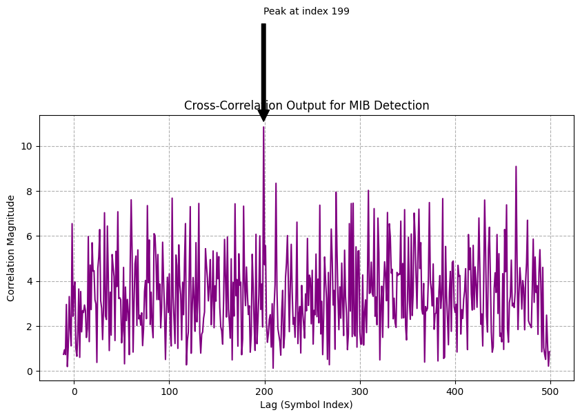

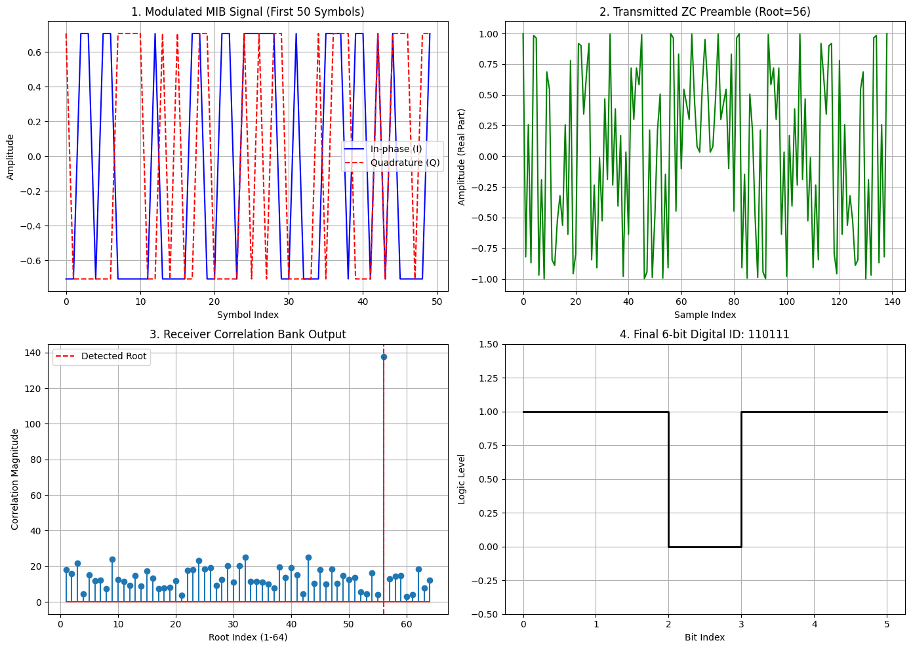

## Notes

- The PDF report is the full written project submission.
- The provided notebooks are the submitted code files for Parts 2, 4, and 5.
- The figures in this README are exported from saved notebook simulation outputs; no handwritten pages are used.
